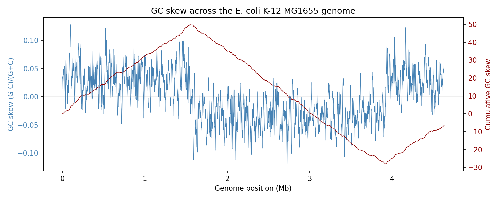
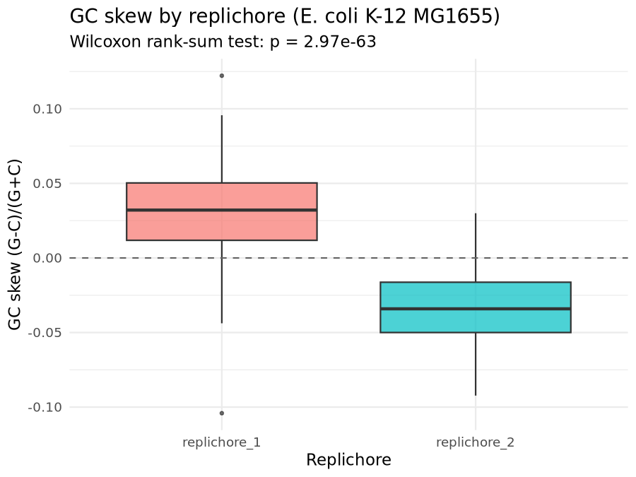

# Sequence Composition, Genome-Scale GC Skew, and Read Quality Statistics in *Escherichia coli*

## Overview

This repository implements four independent, reproducible analyses in computational sequence statistics and quality control, each addressing a distinct question in *Escherichia coli* genomics:

1. **Single-record nucleotide and codon composition** of the *Transposon Tn3* (*E. coli*, GenBank `V00613`) coding sequence.
2. **Genome-scale GC-skew analysis** of the complete *E. coli* K-12 MG1655 chromosome (`NC_000913.3`), used to localize the origin and terminus of replication from sequence composition alone.
3. **Phred quality assessment of real Illumina short-read data**, streamed directly from a public sequencing run (`SRR2584863`) without a full local download.
4. **Formal statistical testing of replichore-level GC-skew asymmetry** via a Wilcoxon rank-sum test, confirming that the compositional bias observed in (2) is not attributable to chance.

Each analysis is self-contained: inputs are fetched programmatically from public databases (NCBI Entrez, ENA) at runtime, and no notebook depends on the output of another except where explicitly noted in the Workflow Pipeline section below.

---

## Repository Architecture

```
bioinfo-statistics-qc/
├── 01_example1_transposon_tn3_composition.ipynb   # Nucleotide/codon composition, Tn3 tnpA CDS
├── 02_example2_genome_gc_skew.ipynb               # Genome-wide GC-skew scan, E. coli K-12 MG1655
├── 03_example3_fastq_read_quality.ipynb           # Phred quality stats, streamed Illumina reads (ENA)
├── 04_example4_skew_significance_py.ipynb         # Replichore-labeled GC-skew table (Python half)
├── 04_example4_skew_significance_r.ipynb          # Wilcoxon test + ggplot2 boxplot (R half)
├── environment.yml                                # Conda/mamba environment specification
├── .gitignore
├── data/                                           # Fetched GenBank/FASTA records (generated at runtime)
│   └── .gitkeep
└── results/                                        # Analysis outputs: tables, summaries, figures
    └── .gitkeep
```

`data/` and `results/` are populated at runtime by the notebooks themselves; only the directory placeholders are tracked by default. The two figures referenced in [Core Findings](#core-findings) below — `results/example2_gc_skew.png` and `results/example4_skew_boxplot.png` — must be committed explicitly for them to render here on GitHub:

```bash
git add results/example2_gc_skew.png results/example4_skew_boxplot.png
git commit -m "Add GC-skew and replichore-significance figures"
```

---

## Environment & Prerequisites

| Component | Version | Role |
|---|---|---|
| Python | 3.11 | Sequence retrieval, composition/codon analysis, GC-skew computation, plotting |
| R | 4.3 | Statistical hypothesis testing, publication-style visualization |
| Biopython | 1.83 | NCBI Entrez access, `SeqRecord`/`SeqFeature` parsing, GC-content utilities |
| requests | 2.31 | Streaming HTTP access to ENA FASTQ data |
| matplotlib | 3.8 | GC-skew trajectory plotting |
| ggplot2 | 3.5.0 | Boxplot visualization of the replichore comparison |
| IRkernel | — | R kernel registration for Jupyter/VS Code |

**Editor:** [Visual Studio Code](https://code.visualstudio.com/), with the Python extension (`ms-python.python`), the Jupyter extension (`ms-toolsai.jupyter`), and the R extension (`REditorSupport.r`).

**Setup:**

```bash
mamba env create -f environment.yml
conda activate bioinfo-skill2-statistics-qc
R -e 'IRkernel::installspec()'   # register the R kernel once
```

Open the project folder in VS Code and select the matching kernel per notebook (Python for notebooks 01–03 and the Python half of 04; R for the R half of 04).

A valid contact e-mail must be set in `Entrez.email` before running any notebook that queries NCBI — this is a requirement of the NCBI E-utilities usage policy, not an optional parameter.

---

## Workflow Pipeline

```
01_example1_transposon_tn3_composition.ipynb
    Entrez.efetch(V00613) → first CDS (tnpA) → base/codon composition
    [independent]

02_example2_genome_gc_skew.ipynb
    Entrez.efetch(NC_000913.3) → 10 kb sliding windows (1 kb step)
    → instantaneous + cumulative GC skew → results/example2_gc_skew_data.csv, .png
    [independent]

04_example4_skew_significance_py.ipynb  (run first)
    Entrez.efetch(NC_000913.3) → same sliding-window skew calculation,
    each window labeled by replichore (oriC = 3.924 Mb, terC = 1.607 Mb)
    → results/example4_skew_values.csv
        │
        ▼
04_example4_skew_significance_r.ipynb  (run second)
    read.csv(results/example4_skew_values.csv)
    → wilcox.test(skew ~ replichore) → results/example4_skew_boxplot.png

03_example3_fastq_read_quality.ipynb
    HTTP stream (ENA, SRR2584863) → first 100 reads only, gzip-decoded in memory
    → per-read Phred+33 mean quality → results/example3_fastq_quality.txt
    [independent]
```

Only the Example 4 pair has a dependency: the Python half must be executed before the R half, since the R notebook reads the CSV the Python notebook writes. Every other notebook runs standalone from a clean kernel.

---

## Core Findings

**1. Tn3 `tnpA` coding-sequence composition.** The transposase CDS (3,048 bp, 1,016 codons) has a GC content of 51.7%, consistent with typical *E. coli* coding-sequence composition. Codon usage is dominated by CTG (Leu), GAA (Glu), GAT (Asp), GCC (Ala), and CAG (Gln) — the same high-frequency codon set characteristic of the *E. coli* K-12 genomic codon table, indicating no strong codon-usage divergence between this mobile genetic element and its host chromosome.

**2. GC skew localizes the replication origin and terminus without annotation.** Across 4,632 overlapping 10 kb windows spanning the 4,641,652 bp MG1655 chromosome, the cumulative GC-skew trajectory reaches its minimum near position 3.921 Mb and its maximum near position 1.549 Mb. These turning points fall within one window (10 kb) of the literature-reported origin of replication, *oriC* (3.924 Mb), and lie close to the replication terminus, *terC* (1.607 Mb) — reproducing, from raw sequence composition alone, the classical leading/lagging-strand asymmetry used to locate replication origins in unannotated bacterial genomes.



*Instantaneous GC skew (blue, left axis) and cumulative GC skew (red, right axis) across the MG1655 chromosome. The cumulative trace peaks near 1.55 Mb and bottoms out near 3.92 Mb, bracketing the genome's two replichores. Generated by `02_example2_genome_gc_skew.ipynb`.*

**3. The replichore asymmetry is statistically significant, not sampling noise.** Partitioning the same 4,632 windows by replichore (rather than by genomic midpoint) and comparing GC skew with a two-sided Wilcoxon rank-sum test gives W = 5,081,505, p < 2.2 × 10⁻¹⁶ (R's floating-point underflow floor). This formally confirms what the cumulative-skew plot shows visually: skew is systematically and significantly biased in opposite directions on the two replichores.



*Per-window GC skew grouped by replichore. Replichore 1 (positions < terC or ≥ oriC) is skewed positive; replichore 2 (between terC and oriC) is skewed negative — the sign flip expected from leading/lagging-strand composition bias. Generated by `04_example4_skew_significance_r.ipynb`.*

**4. Real short-read data meets standard quality thresholds.** Streaming the first 100 reads of public Illumina run SRR2584863 (150 bp reads) directly from ENA — without downloading the full FASTQ file — gives a mean Phred quality of 31.4, with 95/100 reads at or above Q20. This is consistent with a technically sound, modern short-read sequencing run.

---

## Usage & Execution

```bash
# 1. Clone and enter the repository
git clone https://github.com/mohammed-alabbasi/bioinfo-statistics-qc.git
cd bioinfo-statistics-qc

# 2. Build and activate the environment
mamba env create -f environment.yml
conda activate bioinfo-skill2-statistics-qc
R -e 'IRkernel::installspec()'

# 3. Run each notebook from VS Code (or any Jupyter front end), selecting the
#    correct kernel per file. Example 4 must be run in order:
#       04_example4_skew_significance_py.ipynb   (Python kernel)
#       04_example4_skew_significance_r.ipynb    (R kernel)
#    All other notebooks (01, 02, 03) can be run independently, in any order.
```

Each notebook creates its own `data/` and `results/` outputs on first run; no manual directory setup is required beyond the environment build above.
